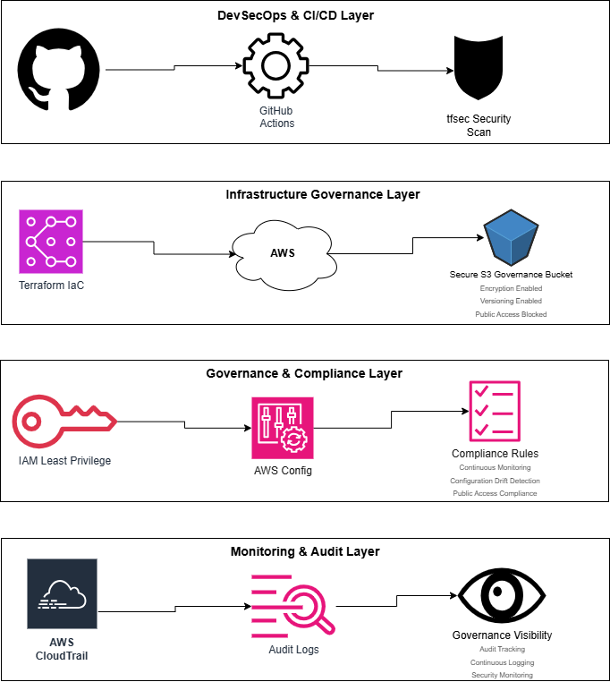
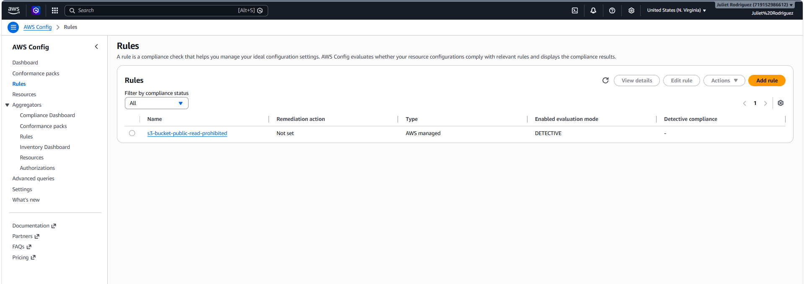

# Cloud Governance Platform
Cloud Governance | DevSecOps | Terraform | AWS Security | Compliance Automation

## Cloud Governance Architecture



## Overview

Terraform for a small, governed AWS footprint (S3, KMS, CloudTrail, AWS Config, IAM), with a CI pipeline where every security check **blocks the merge**: Terraform validation, **tfsec**, **Checkov**, and **OPA/Conftest** policy-as-code.

The point of the project is the governance loop: controls are defined in code, scanners and policies stop a pull request that weakens them, and AWS Config managed rules flag drift after deployment.

---

# What the Terraform deploys

| Area | Resources | Controls |
|---|---|---|
| **Encryption** | `aws_kms_key.governance` (+ alias) | Customer managed key, automatic rotation, key policy that lets CloudTrail and AWS Config use it |
| **S3** (4 buckets: governed data, access logs, CloudTrail, Config) | per bucket: versioning, public access block, encryption, lifecycle, bucket policy | All four public-access settings on; versioning on; SSE-KMS with the CMK (the access-log bucket uses SSE-S3, the only option S3 server access logging supports); TLS-only bucket policies; server access logs for the other three buckets; lifecycle cleanup of failed uploads and year-old versions |
| **Audit logging** | `aws_cloudtrail.governance_trail` | Multi-region, global service events, log file validation, encrypted with the CMK, bucket policy scoped to this trail |
| **IAM** | `aws_iam_policy.s3_governance_policy` | Least privilege: `ListBucket` on the bucket, `GetObject`/`PutObject` on its objects, `Decrypt`/`GenerateDataKey` on the one key |
| **AWS Config** | recorder, delivery channel, recorder status, 14 managed rules | Records all supported and global resource types; recorder is explicitly started |

Account ID, partition, and region come from data sources; nothing account-specific is hard-coded.

## AWS Config managed rules (14)

Each rule checks a control this repo deploys, so a `NON_COMPLIANT` result means drift.

| Rule | Checks |
|---|---|
| `s3-bucket-public-read-prohibited`, `s3-bucket-public-write-prohibited`, `s3-bucket-level-public-access-prohibited` | Public access |
| `s3-bucket-server-side-encryption-enabled` | Bucket encryption |
| `s3-bucket-versioning-enabled` | Versioning |
| `s3-bucket-logging-enabled` | Server access logging |
| `s3-bucket-ssl-requests-only` | TLS-only bucket policies |
| `cloudtrail-enabled`, `multi-region-cloudtrail-enabled`, `cloud-trail-log-file-validation-enabled`, `cloud-trail-encryption-enabled` | The trail |
| `cmk-backing-key-rotation-enabled` | KMS key rotation |
| `iam-policy-no-statements-with-admin-access` | No `*:*` IAM policies |
| `required-tags-s3-buckets` (`REQUIRED_TAGS`) | Project, Environment, Owner, ManagedBy tags on every bucket |

---

# CI/CD pipeline (`.github/workflows/terraform-ci.yml`)

Runs on every push to `main` and every pull request. **All four jobs block the merge.**

| Job | What it checks |
|---|---|
| Format and validate | `terraform fmt -check`, `terraform init -backend=false`, `terraform validate` |
| tfsec (v1.28.0) | Terraform security misconfigurations |
| Checkov (3.x) | A second, broader rule set: 102 checks on this code, 87 pass and 15 are skipped with a written reason |
| OPA / Conftest (0.56.0) | `conftest verify` runs the policy unit tests, then `conftest test` checks the Terraform against the policies |

### Findings: fixed or skipped with a reason

Before this pipeline was made blocking, tfsec reported **33 findings** that couldn't fail the build. They were fixed in the Terraform. The remaining results are skipped **in the code, next to the resource, with the reason**, so a reviewer sees the exception where it applies:

| Scanner check | Resource | Why it's skipped |
|---|---|---|
| Access logging (tfsec `aws-s3-enable-bucket-logging`, Checkov `CKV_AWS_18`) | log bucket | It's the access-log target; logging it to itself would loop |
| Customer managed key (tfsec `aws-s3-encryption-customer-key`, Checkov `CKV_AWS_145`) | log bucket | S3 server access logs can only be delivered to SSE-S3 buckets |
| CloudWatch Logs integration (tfsec, Checkov `CKV2_AWS_10`) | trail | Logs go to an encrypted, versioned S3 bucket; CloudWatch delivery left out to keep the demo low-cost |
| SNS topic (Checkov `CKV_AWS_252`) | trail | No notification consumer in this demo |
| Cross-region replication (`CKV_AWS_144`), event notifications (`CKV2_AWS_62`) | buckets | Single-region demo; no downstream consumer |
| Wildcard resource (tfsec `aws-iam-no-policy-wildcards`) | IAM policy | Object access needs `<bucket>/*`; the wildcard covers objects in that one bucket only |
| `"*"` resource (Checkov `CKV_AWS_109/111/356`) | KMS key policy | In a key policy, `"*"` means "this key" |

Details: [docs/security-findings.md](docs/security-findings.md).

---

# Policy-as-code (`policy/`)

`policy/terraform.rego` (OPA, run by Conftest on the HCL source) enforces the governance standard on every pull request:

- every S3 bucket has the required tags (Project, Environment, Owner, ManagedBy)
- every S3 bucket has a public access block with all four settings on, an encryption configuration, and versioning `Enabled`
- every CloudTrail trail is multi-region, has log file validation, and sets a KMS key
- every KMS key has rotation enabled
- if an AWS Config recorder exists, a recorder status resource turns it on

The files are parsed together (`--combine`), so a rule can check one resource against another, such as a bucket against its public access block. `policy/terraform_test.rego` has **9 unit tests**: one compliant configuration plus one failing case per rule.

```bash
conftest verify --policy policy                          # policy unit tests
conftest test --parser hcl2 --combine terraform/*.tf     # check the Terraform
```

---

# Repository structure

```text
cloud-governance-platform/
├── .github/workflows/terraform-ci.yml   # blocking CI
├── terraform/
│   ├── main.tf           # buckets, CloudTrail, IAM policy, AWS Config recorder
│   ├── s3_hardening.tf   # versioning, public access block, encryption, logging, lifecycle, TLS policies
│   ├── kms.tf            # customer managed key and key policy
│   ├── config_rules.tf   # AWS Config managed rules
│   ├── provider.tf
│   └── versions.tf
├── policy/               # OPA / Conftest policies and their unit tests
├── evidence/             # screenshots from the deployed environment
└── docs/                 # architecture, design, risk register, findings
```

---

# Governance evidence

The `evidence/` screenshots come from the deployed environment **before** the hardening in this version (KMS key, the extra Config rules, logging, TLS-only policies). They show the S3 bucket settings (encryption, public access block, versioning), the CloudTrail trail, the least-privilege IAM policy, and the original AWS Config rule.



Before applying this version to an existing deployment, run `terraform plan`: changing CloudTrail and bucket encryption to the new KMS key and adding bucket policies are in-place updates, and new resources are added. No existing resource address changed.

---

# Future enhancements

- AWS Security Hub integration
- Multi-environment Terraform (dev / prod) with remote state
- CloudTrail to CloudWatch Logs with metric filters and alarms
- Plan-time policy checks (Conftest on `terraform show -json` output) once CI has AWS credentials through OIDC

---

# License

MIT. See [LICENSE](LICENSE).

# Author

Juliet Rodriguez

Cloud Governance | DevSecOps | Infrastructure Security
